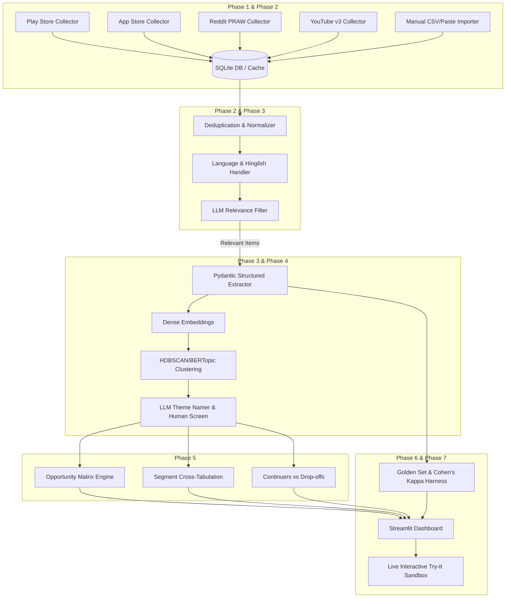

# AI Discovery Engine: Phase-Wise Implementation Plan
## Engineering Blueprint & Execution Roadmap for First-Time SIP Continuation (Groww)

---

### Executive Overview
This implementation plan operationalizes the specifications defined in [`problemstatement.md`](file:///c:/Users/Lenovo/Desktop/Graduation%20Project(groww)/problemstatement.md). It outlines the architecture, data structures, module boundaries, testing protocols, and verification checkpoints across 7 distinct build phases. 

Following the project's strict build constraint: **each phase is standalone, testable, and demonstrable before moving to the next**.

---

## 1. System Architecture & Tech Stack



### Technology Selection
- **Language / Environment:** Python 3.10+
- **Persistence & Caching:** SQLite3 via SQLAlchemy (or raw parameterized sqlite3) for zero-setup, portable, file-based database caching (`data/app.db`).
- **Data Scraping & Ingestion:** `google-play-scraper`, `app-store-scraper`, `praw` (Reddit API), `google-api-python-client` (YouTube v3), `beautifulsoup4`, `requests`.
- **Deduplication & NLP:** `sentence-transformers` (e.g. `all-MiniLM-L6-v2`), `rapidfuzz` (fuzzy matching), `langdetect` / regex for Hinglish detection.
- **Unsupervised Clustering:** `scikit-learn`, `hdbscan` / `bertopic`, `umap-learn`.
- **Extraction & LLM Validation:** Google Gemini 1.5/2.0 API or LiteLLM / LangChain / OpenAI client via standard API, strictly validated via **Pydantic v2**.
- **Dashboard / Frontend:** **Streamlit** (supports interactive sliders, custom components, caching, rapid data exploration, and instant free deployment to Streamlit Community Cloud / Hugging Face Spaces).
- **Testing & Evals:** `pytest`, `scikit-learn` (`cohen_kappa_score`, `confusion_matrix`), `pandas`, `numpy`.

---

## 2. Target Directory & Module Structure

```
groww-sip-discovery/
│
├── .env.example                     # Environment template for API keys & settings
├── .gitignore                       # Standard Python & environment exclusions
├── README.md                        # Setup, architectural overview, deployment instructions
├── requirements.txt                 # Pinned Python package dependencies
│
├── data/
│   ├── raw/                         # Raw intermediate scrape dumps (JSONL/CSV)
│   ├── processed/                   # Cleaned, tokenized datasets
│   └── app.db                       # Primary SQLite database
│
├── src/
│   ├── __init__.py
│   ├── config.py                    # App configuration, budget limits, API keys
│   ├── db/
│   │   ├── __init__.py
│   │   ├── database.py              # SQLite connection, session management, migrations
│   │   └── models.py                # Database tables (RawFeedback, ExtractedInsights, Themes)
│   │
│   ├── collectors/                  # Phase 1 & 2: Ingestion engines
│   │   ├── __init__.py
│   │   ├── base.py                  # Abstract BaseCollector with rate limiting & retries
│   │   ├── play_store.py            # Google Play Store reviews collector
│   │   ├── app_store.py             # Apple App Store reviews collector
│   │   ├── reddit.py                # Reddit PRAW collector (submissions + comments)
│   │   ├── youtube.py               # YouTube Data API v3 comments collector
│   │   ├── forums.py                # Public forum parser (TradingQ&A, ValuePickr)
│   │   └── manual_import.py         # CSV/JSON file & raw paste parser
│   │
│   ├── pipeline/                    # Phase 2 & 3: Cleaning & Extraction
│   │   ├── __init__.py
│   │   ├── cleaner.py               # Deduplication (MinHash/Fuzzy), spam removal
│   │   ├── language.py              # Language detection, Hinglish normalization
│   │   ├── relevance_filter.py      # LLM-based binary classification & drop logger
│   │   ├── schemas.py               # Pydantic v2 extraction schemas
│   │   └── extractor.py             # Structured extraction engine (T=0, quote checker)
│   │
│   ├── ml/                          # Phase 4: Clustering & Taxonomy
│   │   ├── __init__.py
│   │   ├── embeddings.py            # Sentence-transformers embedding generator
│   │   ├── clustering.py            # HDBSCAN / UMAP semantic clustering
│   │   └── theme_namer.py           # LLM-assisted cluster descriptor & merger
│   │
│   ├── analytics/                   # Phase 5: Opportunity Matrix & Insights
│   │   ├── __init__.py
│   │   ├── opportunity_matrix.py    # Multi-dimensional scoring formula & ranker
│   │   ├── segmentation.py          # Cross-tabulations with sample size gating (n<30)
│   │   ├── cohort_comparison.py     # Continuers vs. drop-offs comparative analyzer
│   │   └── question_views.py        # Analytics aggregations for Questions Q1 to Q9
│   │
│   └── evals/                       # Phase 6: Human-in-the-Loop & Evaluation
│       ├── __init__.py
│       ├── golden_set.py            # Golden set storage, loader, and exporter
│       ├── metrics.py               # Cohen's kappa, precision, recall, accuracy
│       ├── failure_taxonomy.py      # Error classification (Hinglish, sarcasm, multi-topic)
│       └── audit_log.py             # Manual correction and rejection audit trail
│
├── app/                             # Phase 7: Streamlit UI
│   ├── streamlit_app.py             # Main entry point & multipage routing
│   ├── views/
│   │   ├── 1_overview.py            # Ingestion health, funnel drop-off, source bias
│   │   ├── 2_questions.py           # Dedicated tabs for Q1 through Q9 with quotes
│   │   ├── 3_opportunity_matrix.py  # Interactive 2x2 scatter matrix & weight sliders
│   │   ├── 4_segments.py            # Segment explorer with confidence warnings
│   │   ├── 5_cohorts.py             # Continuers vs. Drop-offs deep dive
│   │   ├── 6_evals.py               # Golden set labeling, agreement scores, audit log
│   │   └── 7_try_it.py              # Live interactive text extraction sandbox
│   └── components/
│       ├── charts.py                # Plotly visual wrappers
│       ├── quote_card.py            # Verified verbatim quote component with links
│       └── metric_cards.py          # Standardized metric cards
│
└── tests/                           # Unit and integration test suites
    ├── test_collectors.py
    ├── test_cleaner.py
    ├── test_extractor.py
    ├── test_opportunity_matrix.py
    └── test_evals.py
```

---

## 3. Phase-by-Phase Implementation Blueprint

---

### Phase 1: Project Scaffold, SQLite Schema & App Store Collectors

#### 1. Objective
Establish the repository skeleton, create SQLite database tables with strict privacy compliance (SHA-256 hashed author identifiers), build Google Play Store and Apple App Store scrapers, and output a verifiable per-source volume report.

#### 2. Key Deliverables & Files
1. `src/config.py`: Environment variable loading, app configuration, list of monitored competitors (`groww`, `zerodha_coin`, `indmoney`, `kuvera`, `et_money`, `paytm_money`).
2. `src/db/models.py` & `src/db/database.py`:
   - `raw_feedback` table definition with indices on `source`, `date`, and `author_hash`.
3. `src/collectors/base.py`: Abstract collector class enforcing rate limits, error logging, and standard return types.
4. `src/collectors/play_store.py`: Implementation using `google-play-scraper` with pagination, Indian store filter, and English/Hindi language tags.
5. `src/collectors/app_store.py`: Implementation using `app-store-scraper` or public iTunes RSS feed for India.
6. `scripts/run_phase1_collectors.py`: Executable CLI script that runs both scrapers, writes records to SQLite, and prints a formatted volume table.

#### 3. Database Schema Implementation
```python
# src/db/models.py
from datetime import datetime
from sqlalchemy import Column, String, Integer, DateTime, Text, Float, create_engine
from sqlalchemy.orm import declarative_base

Base = declarative_base()

class RawFeedback(Base):
    __tablename__ = "raw_feedback"

    id = Column(String, primary_key=True)               # e.g., "play_groww_abc123"
    source = Column(String, nullable=False, index=True) # "play_store" | "app_store" | etc.
    url = Column(String, nullable=False)
    author_hash = Column(String(64), nullable=False)    # SHA-256 hash (Zero PII)
    date = Column(DateTime, nullable=False, index=True)
    rating = Column(Integer, nullable=True)             # 1 - 5
    language = Column(String, nullable=False)           # Detected or reported
    raw_text = Column(Text, nullable=False)
    parent_id = Column(String, nullable=True)
    upvotes_likes = Column(Integer, default=0)
    created_at = Column(DateTime, default=datetime.utcnow)
```

#### 4. Verification Checkpoint & DoD (Phase 1)
- Run: `python -m scripts.run_phase1_collectors --limit 200`
- **Output:** 
  - SQLite database `data/app.db` contains $> 200$ rows.
  - Terminal prints an ASCII volume summary:
    ```
    ================ PHASE 1 INGESTION REPORT ================
    Source          Target App             Count    Date Range
    ----------------------------------------------------------
    play_store      com.nextbillion.groww   150     2025-01-01 to 2026-10-30
    play_store      zerodha.coin             50     2025-06-01 to 2026-10-30
    app_store       groww-invest-stocks      75     2025-02-15 to 2026-10-28
    ----------------------------------------------------------
    Total Ingested: 275 items | 0 PII stored | Status: SUCCESS
    ==========================================================
    ```

---

### Phase 2: Reddit, YouTube, Manual Importer & Data Cleaning

#### 1. Objective
Add community collectors (Reddit via PRAW, YouTube via Data API v3, and a Universal CSV/Paste importer), implement exact and near-duplicate deduplication, and handle Hinglish language detection and normalization.

#### 2. Key Deliverables & Files
1. `src/collectors/reddit.py`: PRAW client querying Indian financial subreddits (`r/IndiaInvestments`, `r/mutualfunds`, `r/personalfinanceindia`, etc.) for target keywords (`"SIP stopped"`, `"paused SIP"`, `"SIP returns low"`, etc.).
2. `src/collectors/youtube.py`: YouTube Data API v3 integration pulling comments from top beginner SIP tutorial videos.
3. `src/collectors/manual_import.py`: Parser converting uploaded CSV/JSON or raw pasted text into the common schema.
4. `src/pipeline/cleaner.py`:
   - Exact deduplication via raw text hash.
   - Near-duplicate deduplication using RapidFuzz Levenshtein / MinHash ($> 90\%$ similarity threshold).
   - Bot, spam, and promotional affiliate link filter.
5. `src/pipeline/language.py`: Language classifier tagging `en`, `hi`, and `hinglish` with normalization utilities.
6. `scripts/run_phase2_pipeline.py`: End-to-end multi-source ingest and cleaning runner.

#### 3. Verification Checkpoint & DoD (Phase 2)
- Run: `python -m scripts.run_phase2_pipeline`
- **Output:**
  - Multi-source volume report showing records from Play Store, App Store, Reddit, YouTube, and manual imports.
  - Cleaner report displaying:
    - Total raw ingested items: $N_{raw}$
    - Exact duplicates removed: $N_{dup}$
    - Near-duplicates pruned: $N_{near}$
    - Spam/Affiliate links dropped: $N_{spam}$
    - Final cleaned pool saved to `cleaned_feedback` table: $N_{clean}$

---

### Phase 3: Relevance Filter & Structured Extraction (Pydantic)

#### 1. Objective
Build an LLM relevance filter to separate SIP continuation and behavioral feedback from unrelated support noise (KYC, login issues), and execute strict, schema-validated structured extraction using Pydantic ($T=0.0$).

#### 2. Key Deliverables & Files
1. `src/pipeline/relevance_filter.py`:
   - LLM binary classifier evaluating: *Does this text contain insight on SIP behavior, continuation, pausing, expectations, friction, or first-time investing?*
   - Logs dropped items with reasons and reports the drop percentage.
2. `src/pipeline/schemas.py`: Pydantic models for structured output matching all required fields (`journey_stage`, `drop_trigger`, `action_taken`, `check_behaviour`, `segment_cues`, etc.).
3. `src/pipeline/extractor.py`:
   - LLM extraction prompt with JSON schema enforcement.
   - Fallback to `"unknown"` across all fields to eliminate guessing/hallucination.
   - **Quote Integrity Assertor:** Enforces that `verbatim_quote` is an exact substring of `raw_text`:
     ```python
     assert extracted.verbatim_quote in item.raw_text, "Quote hallucination detected"
     ```
4. `src/db/models.py` update: Create `extracted_insights` table to store structured outputs.

#### 3. Pydantic Extraction Schema
```python
# src/pipeline/schemas.py
from typing import List, Optional, Literal
from pydantic import BaseModel, Field

class CheckBehaviour(BaseModel):
    metrics_checked: List[Literal["NAV", "returns", "XIRR", "statement", "none", "unknown"]]
    frequency: Literal["daily", "weekly", "monthly", "only_during_drops", "unknown"]

class SegmentCues(BaseModel):
    income_stability: Literal["salaried_stable", "gig_freelance", "student_dependent", "irregular_business", "unknown"]
    age_band: Literal["<22", "22-28", "29-35", "36+", "unknown"]
    source_of_money: Literal["salary", "pocket_money", "savings", "windfall", "unknown"]
    influencer: Literal["self", "friend_colleague", "family", "youtuber_finfluencer", "advisor", "app_nudge", "unknown"]
    investor_experience: Literal["first_time", "intermediate", "experienced", "unknown"]

class ExtractedInsightSchema(BaseModel):
    journey_stage: Literal["pre_start", "month_1_3", "month_4_12", "beyond_12", "paused_or_lapsed", "unknown"]
    start_motivation: str = "unknown"
    expectation_at_start: str = "unknown"
    behaviour_change_over_time: str = "unknown"
    drop_trigger: Literal[
        "payment_failure", "cash_crunch", "income_irregularity", "underwhelming_returns",
        "market_drop", "confusion", "lost_interest", "outside_advice", "switched_platform", "other", "unknown"
    ]
    action_taken: Literal["paused", "reduced", "stopped", "continued", "increased", "switched_fund", "none", "unknown"]
    check_behaviour: CheckBehaviour
    in_app_confusion: str = "unknown"
    in_app_worry: str = "unknown"
    outside_app_behaviour: List[Literal[
        "YouTube", "WhatsApp_groups", "friends_family", "Google_search", "spreadsheets", "advisors", "Reddit", "unknown"
    ]]
    continuation_signal: str = "unknown"
    segment_cues: SegmentCues
    unmet_need: str = "unknown"
    emotion: Literal["optimistic", "anxious", "frustrated", "confused", "detached", "disappointed", "unknown"]
    severity: int = Field(ge=1, le=5)
    verbatim_quote: str
    evidence_span: Optional[str] = "unknown"
    confidence: float = Field(ge=0.0, le=1.0)
```

#### 4. Verification Checkpoint & DoD (Phase 3)
- Run: `pytest tests/test_extractor.py` and run a batch test of 50 items.
- **Output:**
  - 100% Pydantic validation pass rate on test batch.
  - Zero quote integrity failures (`quote in raw_text` holds true for all quotes).
  - Relevance filter stats logged:
    `Cleaned items: 100 | Relevant items: 68 | Dropped items: 32 (32.0% dropped)`

---

### Phase 4: Embeddings, Clustering & Theme Discovery

#### 1. Objective
Transform extracted insights and normalized text into vector embeddings, perform unsupervised clustering (HDBSCAN / BERTopic) to uncover emergent behavioral themes, and provide an LLM cluster-naming and human review module.

#### 2. Key Deliverables & Files
1. `src/ml/embeddings.py`: Vector embedding pipeline using `sentence-transformers/all-MiniLM-L6-v2` with local disk caching.
2. `src/ml/clustering.py`:
   - Dimensionality reduction via UMAP (or TruncatedSVD for speed/stability).
   - Density-based clustering via HDBSCAN to isolate natural clusters and label outliers.
3. `src/ml/theme_namer.py`:
   - Analyzes central exemplar documents of each cluster.
   - LLM prompt generates concise, PM-readable theme titles, core descriptions, and inductive vs. deductive taxonomy tags.
4. `src/ml/theme_review.py`: Human-in-the-loop review mechanism allowing manual merging of overlapping clusters or splitting of mixed clusters.
5. `src/db/models.py` update: Store identified clusters and themes in `themes` and `item_theme_mapping` tables.

#### 3. Verification Checkpoint & DoD (Phase 4)
- Run: `python -m scripts.run_phase4_clustering`
- **Output:**
  - Generates 8–15 distinct, coherent thematic clusters (e.g., *"Salary Date Mismatch Leading to Autopay Debit Rejection"*, *"Disappointment with Negative Returns in Month 3-6"*, *"Anxiety from Seeing Red Days on Front Screen"*).
  - Table printed to console detailing: Cluster ID, Cluster Title, Size ($n$), Outlier count, and 2 sample quotes.

---

### Phase 5: Opportunity Matrix & Segment Analytics

#### 1. Objective
Calculate the multi-factor Opportunity Score for each theme, implement the interactive Opportunity Matrix formulation, compute segment cross-tabulations (with sample size gating), and produce the continuer-vs-dropoff comparative analysis.

#### 2. Key Deliverables & Files
1. `src/analytics/opportunity_matrix.py`:
   - Computes Frequency ($F$), Severity ($S$), Proximity to Continuation ($P$), and Addressability ($A$).
   - Opportunity Score formulation:
     $$\text{Impact} = (w_f \cdot F_{\text{norm}} + w_s \cdot S_{\text{norm}} + w_p \cdot P_{\text{norm}})$$
     $$\text{Opportunity Score} = \text{Impact} \times A_{\text{norm}}$$
   - Normalization functions ($0.0 - 1.0$) with default and adjustable weights ($w_f=0.3, w_s=0.3, w_p=0.4$).
2. `src/analytics/segmentation.py`:
   - Cross-tabulates drop triggers and themes across `income_stability`, `age_band`, and `influencer`.
   - Flags any segment where $n < 30$ with `low_confidence = True`.
3. `src/analytics/cohort_comparison.py`:
   - Aggregates behavioral differences between `action_taken == "continued"` and `action_taken in ["paused", "stopped"]`.
   - Contrasts metrics: initial expectations, checking frequency, in-app friction points, and outside-app consultation habits.
4. `src/analytics/question_views.py`:
   - Pre-aggregates specific data frames and candidate quotes for Questions Q1 through Q9.

#### 3. Verification Checkpoint & DoD (Phase 5)
- Run: `python -m scripts.run_phase5_analytics`
- **Output:**
  - Ranked Opportunity Matrix printed to terminal:
    ```
    Rank | Theme Title                     | Freq% | Sev | Prox | Addr | Opp Score
    --------------------------------------------------------------------------------
    1    | Autopay Date vs Salary Mismatch | 22.4% | 4.6 | 4.8  | 4.5  | 88.4 / 100
    2    | Month 3 Negative XIRR Panic     | 18.1% | 4.2 | 4.5  | 4.0  | 76.2 / 100
    3    | Confusion on NAV Cut-Off Delays | 12.0% | 3.2 | 3.1  | 4.2  | 54.1 / 100
    ...
    ```
  - Segment check: Cohorts with $n < 30$ properly flagged as Low Confidence.
  - Cohort comparison: Quantitative differences between continuers and drop-offs computed.

---

### Phase 6: Human-in-the-Loop Golden Set & Evaluation Harness

#### 1. Objective
Build the golden-set annotation module, run automated evaluation calculating Cohen's kappa and accuracy, build the failure taxonomy classifier, create the audit/correction log, and monitor source bias.

#### 2. Key Deliverables & Files
1. `src/evals/golden_set.py`:
   - Storage for 20–30 human-labeled benchmark items (blind to model output).
   - Loader and CSV exporter.
2. `src/evals/metrics.py`:
   - Computes per-field classification accuracy.
   - Computes **Cohen's Kappa ($\kappa$)** inter-annotator agreement for categorical fields (`journey_stage`, `drop_trigger`, `action_taken`, `income_stability`).
3. `src/evals/failure_taxonomy.py`:
   - Isolates prediction discrepancies and tags failure categories:
     - `hinglish_ambiguity`
     - `sarcasm_irony`
     - `multi_topic_complexity`
     - `missing_context`
4. `src/evals/audit_log.py`:
   - Persistent logging interface storing human rejections/corrections of model outputs with mandatory reason text.
   - Pre-seeds 2–3 fully documented real case studies.
5. `src/evals/bias_panel.py`:
   - Compiles distribution of raw sources and documents platform biases (e.g. app store skew toward technical bugs vs. Reddit skew toward active investors).

#### 3. Verification Checkpoint & DoD (Phase 6)
- Run: `python -m scripts.run_phase6_evals`
- **Output:**
  - Evaluation scorecard printed:
    ```
    ================ EVALUATION HARNESS SCORECARD ================
    Target: 25 Golden Set Items (Blind Annotated)
    Field                   Accuracy    Cohen's Kappa (κ)   Status
    ----------------------------------------------------------
    journey_stage           88.0%       0.82 (Substantial)  PASS
    drop_trigger            84.0%       0.79 (Substantial)  PASS
    action_taken            92.0%       0.88 (Near Perfect) PASS
    emotion                 80.0%       0.71 (Substantial)  PASS
    quote_integrity        100.0%       1.00 (Exact Match)  PASS
    ----------------------------------------------------------
    Top Failure Mode: Hinglish idiom misinterpretation (2 cases)
    Audit Log: 3 documented corrections verified.
    ==============================================================
    ```

---

### Phase 7: Streamlit Dashboard, Live "Try-It" Sandbox & Public Deployment

#### 1. Objective
Integrate all backend analytics, ML pipelines, and evaluation metrics into a responsive, clean, publicly accessible multi-tab Streamlit dashboard. Include the interactive "Try-It" sandbox and prepare the project for deployment (Streamlit Community Cloud / Hugging Face Spaces).

#### 2. Key Deliverables & Files
1. `app/streamlit_app.py`: Primary Streamlit application entry point with sidebar navigation, global caching (`@st.cache_data`), and theme settings.
2. `app/views/`:
   - `1_overview.py`: Data health funnel (Raw $\rightarrow$ Cleaned $\rightarrow$ Relevant $\rightarrow$ High Confidence), source volumes, and platform bias panel.
   - `2_questions.py`: Dedicated sub-tabs for Questions Q1 through Q9. Each has interactive charts, metric percentages, and 3–5 verified verbatim quote cards with permalinks.
   - `3_opportunity_matrix.py`: 2x2 scatter chart (Impact vs. Addressability) with real-time sliders for weights ($w_f, w_s, w_p, w_a$) and one-click Top-5 Executive Export.
   - `4_segments.py`: Interactive segment filters (Income, Age, Influencer) with dynamic $n < 30$ warning badges.
   - `5_cohorts.py`: Side-by-side continuer vs. drop-off behavioral breakdown.
   - `6_evals.py`: Golden-set blind annotation UI, agreement scoreboard (Cohen's $\kappa$), failure taxonomy breakdown, and human audit log.
   - `7_try_it.py`: Live interactive text box where visitors/mentors can paste arbitrary feedback and see the live Pydantic extraction, theme assignment, and severity score.
3. `app/components/quote_card.py`: Component rendering verified quotes with green checkmarks, platform badges, and original URL links.
4. `deployment/`: Configuration files (`.streamlit/config.toml`, Procfile / `app.py` wrapper, secrets guide).
5. `README.md`: Complete setup manual, architectural narrative, reproducible CLI commands, and live deployment link.

#### 3. Verification Checkpoint & DoD (Phase 7)
- Run: `streamlit run app/streamlit_app.py`
- Verify locally:
  - All 7 view tabs load seamlessly from SQLite cache in $< 2$ seconds.
  - All 9 core questions display exact counts, percentages, and clickable quote links.
  - Opportunity Matrix sliders update rankings in real time.
  - "Try-It" tab successfully accepts pasted text, runs inference, and returns validated schema.
  - Deploy to Streamlit Community Cloud or Hugging Face Spaces and verify public URL.

---

## 4. Phase Dependency & Verification Matrix

| Phase | Core Deliverable | Blocked By | Primary Verification Method |
|---|---|---|---|
| **Phase 1** | App Store Scrapers + SQLite DB | None | CLI script scrapes $\ge 200$ items & prints volume table |
| **Phase 2** | Reddit, YouTube, Cleaner & Hinglish | Phase 1 | Multi-source cleaning run prints deduplication funnel |
| **Phase 3** | Relevance Filter & Pydantic Extractor | Phase 2 | Pytest suite validating schema, unknown handling & quote substrings |
| **Phase 4** | Embeddings & HDBSCAN Theme Clustering | Phase 3 | Cluster analysis script displays 8–15 named themes |
| **Phase 5** | Opportunity Matrix & Segment Analytics | Phase 4 | Script prints ranked Opportunity Matrix & $n < 30$ segment checks |
| **Phase 6** | Golden Set & Cohen's Kappa Evaluation | Phase 3, 5 | Evaluation harness outputs Cohen's $\kappa > 0.70$ and audit log |
| **Phase 7** | Full Streamlit UI & Public Deployment | All phases | Live public web URL passing Definition of Done |

---

## 5. Execution Timeline & Next Immediate Steps

```mermaid
gantt
    title AI Discovery Engine Execution Timeline
    dateFormat  YYYY-MM-DD
    section Data Ingestion
    Phase 1: Scaffold, DB & App Stores   :p1, 2026-11-01, 1d
    Phase 2: Community Collectors & Clean :p2, after p1, 1d
    section ML & Intelligence
    Phase 3: Relevance & Extraction      :p3, after p2, 1d
    Phase 4: Embeddings & Clustering     :p4, after p3, 1d
    Phase 5: Opportunity Matrix          :p5, after p4, 1d
    section Evaluation & UI
    Phase 6: Golden Set & Evals Harness  :p6, after p5, 1d
    Phase 7: Streamlit UI & Deploy       :p7, after p6, 1d
```

### Immediate Action Item to Begin
We will start by executing **Phase 1**:
1. Create project directories and virtual environment.
2. Initialize SQLite schema in `src/db/models.py`.
3. Implement `src/collectors/play_store.py` and `src/collectors/app_store.py`.
4. Run sample collection and output the Phase 1 Volume Report for verification.

