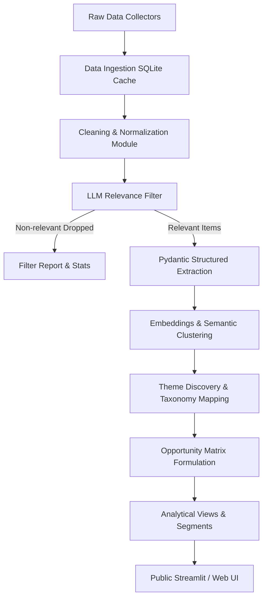

# AI Discovery Engine for First-Time SIP Continuation (Groww)
## Comprehensive Problem Statement & System Specifications

---

### Executive Summary & Role Definition
- **Role:** Senior Full-Stack + ML Engineer
- **Target User:** Product Manager on the Growth Team at **Groww** (Leading Indian investment & wealth management platform).
- **Core Product:** AI Discovery Engine capable of ingesting public conversations at scale, extracting structured behavioral insights using LLMs, clustering emergent themes, and calculating quantified, actionable product opportunity scores.

---

## 1. Problem Statement & Strategic Objective

### Strategic Context
Groww's high-priority strategic growth goal is to **increase the percentage of first-time mutual fund investors who maintain an active Systematic Investment Plan (SIP) 12 months after initiating their first SIP**.

$$\text{Active SIP} = \text{At least one successful instalment debit within the trailing 30 days}$$

### The Core Problem
While initial user acquisition and first-time SIP activation funnels are strong, **continuation significantly breaks down within the first 12 months**. Groww does not yet know **WHY** continuation breaks down:
- What behavioral, psychological, and financial triggers cause first-time investors to pause, stop, or drop off?
- How do user expectations set on Day 1 deviate from lived experiences over Months 1–12?
- What distinguishes investors who successfully persist from those who silently lapse?

### Solution Objective
Design, build, and deploy an end-to-end **AI Discovery Engine** that:
1. Ingests raw, public conversations about SIPs and first-time mutual fund investing across Indian digital ecosystems at scale (2,000–5,000 items).
2. Normalizes, cleans, and filters data (supporting Hinglish and multi-platform noise).
3. Executes rigorous, schema-validated structured extraction with LLMs.
4. Uncovers emergent problem spaces via unsupervised clustering and thematic discovery.
5. Produces a quantified, comparable **Opportunity Matrix** (Impact vs. Addressability) rather than vague summaries or high-level sentiment scores.
6. Powers an interactive, deployable dashboard enabling growth PMs to drill down into root causes with source-linked verbatim evidence.

---

## 2. Core Questions the Engine Must Answer

The system and dashboard must provide dedicated analytical views for **9 core behavioral questions**. Each question view must feature:
- Quantified frequency counts ($n$)
- Percentage distributions ($\%$)
- 3–5 verbatim, authenticated supporting quotes with direct source hyperlinks.

| # | Question | Key Focus Areas |
|---|----------|-----------------|
| **Q1** | **Why do people start a SIP, and what do they expect?** | Wealth creation, financial discipline, peer/family pressure, tax saving, unrealistic short-term return expectations vs. reality. |
| **Q2** | **What changes in their behaviour in the months after starting?** | Shift from high engagement to checking anxiety, neglect, confusion as market cycles fluctuate, habit decay. |
| **Q3** | **What leads investors to pause, reduce or stop a SIP?** | Bank autopay/e-mandate failures, temporary cash crunches, market downturn panic, underwhelming returns, loss of confidence. |
| **Q4** | **What do investors check, and how often, once they have started?** | Portfolio NAV, day-to-day returns, absolute returns vs. XIRR, monthly account statements; daily vs. weekly vs. monthly cadence. |
| **Q5** | **What confuses or worries them inside the app?** | NAV cut-off timings, ledger settlement delays, portfolio red days, XIRR calculations, SIP edit/pause UI, transaction statuses. |
| **Q6** | **What do they do outside the app when they feel unsure?** | Consult YouTube "finfluencers", seek validation on Reddit/WhatsApp groups, Google frantic queries, rely on family/peer advice. |
| **Q7** | **What separates continuers from quiet drop-offs?** | Preparedness for volatility, understanding of rupee cost averaging, automated salary alignment, long-term mental models. |
| **Q8** | **How do patterns differ across user segments?** | Segmentation by income stability, age brackets, source of funds, primary influencer/onboarding catalyst. |
| **Q9** | **What unmet needs emerge consistently across conversations?** | Automated emergency pause mechanisms, visual milestone tracking, relatable benchmark comparisons, proactive debit reminders. |

---

## 3. Data Sources & Ingestion Specifications

The engine must implement **modular, standalone collector modules** with retry logic, rate-limit handling, and resumable execution.

### Target Volume
- **2,000 to 5,000** total raw records across sources.
- Per-source volume, coverage, and ingest health reports.

### Monitored Data Channels

1. **Google Play Store Reviews**
   - **Target Apps:** Groww + Primary Competitors (*Zerodha Coin, INDmoney, Kuvera, ET Money, Paytm Money*).
   - **Tooling:** `google-play-scraper`.
   - **Filters:** Region: India (`in`), Languages: English (`en`) and Hindi (`hi`).

2. **Apple App Store Reviews**
   - **Target Apps:** Groww and key competitors.
   - **Tooling:** `app-store-scraper` or public iTunes RSS review feeds.
   - **Filters:** India Storefront.

3. **Reddit Communities**
   - **Target Subreddits:** `r/IndiaInvestments`, `r/IndianStockMarket`, `r/personalfinanceindia`, `r/mutualfunds`, `r/DalalStreetTalks`, `r/indianstreetbets`.
   - **Tooling:** Official Reddit API via `praw` (credentials managed via `.env`).
   - **Query Vectors:** `"SIP stopped"`, `"paused SIP"`, `"SIP not working"`, `"first SIP"`, `"SIP returns low"`, `"SIP failed"`, `"autopay failed"`, `"should I stop SIP"`, `"Groww SIP"`, `"Zerodha Coin SIP"`.
   - **Scope:** Post submissions and top-level comments.

4. **YouTube Comment Streams**
   - **Channels / Videos:** High-reach Indian personal finance channels (e.g., beginner-focused mutual fund tutorials, SIP strategy videos).
   - **Tooling:** YouTube Data API v3 (`.env` configured).
   - **Scope:** Public top-level comments and discussions.

5. **Investing & Community Forums**
   - **Forums:** *TradingQ&A*, *ValuePickr*, *Groww Community*, *Quora* (public indexed threads).
   - **Governance:** Respect `robots.txt` and rate limits; graceful exception handling and skip logging if blocked.

6. **Social Media Fallback (Manual Import)**
   - For platforms with strict Terms of Service (X/Twitter, private Facebook groups, Telegram channels): **No direct automated scraping**.
   - Provide a structured **manual import pipeline** (CSV/JSON/raw paste) on the UI.

7. **Universal UI Upload Fallback**
   - Direct web UI drag-and-drop / paste interface supporting CSV and JSON imports.

---

## 4. Standardized Data Schema

Every ingested item across all collector sources must immediately be normalized into a unified schema stored in SQLite:

```typescript
interface RawFeedbackItem {
  id: string;               // Unique primary key (source-prefixed, e.g. "play_groww_10482")
  source: string;           // "play_store" | "app_store" | "reddit" | "youtube" | "forum" | "manual_import"
  url: string;              // Direct permalink to post/review
  author_hash: string;      // SHA-256 hashed author identifier (strictly zero PII)
  date: string;             // ISO-8601 formatted date (YYYY-MM-DDTHH:MM:SSZ)
  rating?: number | null;   // Numeric rating 1-5 (where applicable, e.g. store reviews)
  language: string;         // Detected language ("en", "hi", "hinglish", etc.)
  raw_text: string;         // Unaltered, raw content body
  parent_id?: string | null;// Thread parent / video ID / submission ID
  upvotes_likes?: number;   // Upvotes, helpfulness marks, or thumbs up count
}
```

---

## 5. End-to-End Processing & ML Pipeline

The processing pipeline is modular, idempotent, and backed by a local SQLite database with intermediate caching.



### Step 1: Ingestion & Resumable Collection
- Robust rate limiting, exponential backoff, and state persistence to resume interrupted crawls without duplicate requests.

### Step 2: Data Cleaning & Normalization
- Exact and near-duplicate deduplication (MinHash / fuzzy matching).
- Bot, spam, and promotional affiliate link detection and removal.
- Language identification capable of detecting **Hinglish** (code-mixed Hindi-English).
- Text normalization/translation to English stored alongside the intact `raw_text`.

### Step 3: LLM Relevance Filter
- **Filtering Objective:** Retain items discussing SIP behavior, continuation, pausing, confusion, financial expectations, trust, or first-time investing.
- **Exclusion Criteria:** Discard pure KYC delays, basic login lockouts, bank OTP timeouts, or isolated account withdrawal tickets unless explicitly related to SIP continuation or debit failure.
- **Funnel Metric:** Log and report the precise percentage of records filtered out at this stage.

### Step 4: Strict Structured Extraction (Pydantic & JSON Schema)
Executed with temperature $T = 0.0$ and validated through Pydantic models. Every attribute allows `"unknown"` to prevent LLM hallucinations.

```json
{
  "journey_stage": "pre_start | month_1_3 | month_4_12 | beyond_12 | paused_or_lapsed | unknown",
  "start_motivation": "string | unknown",
  "expectation_at_start": "string | unknown",
  "behaviour_change_over_time": "string | unknown",
  "drop_trigger": "payment_failure | cash_crunch | income_irregularity | underwhelming_returns | market_drop | confusion | lost_interest | outside_advice | switched_platform | other | unknown",
  "action_taken": "paused | reduced | stopped | continued | increased | switched_fund | none | unknown",
  "check_behaviour": {
    "metrics_checked": ["NAV", "returns", "XIRR", "statement", "none", "unknown"],
    "frequency": "daily | weekly | monthly | only_during_drops | unknown"
  },
  "in_app_confusion": "string | unknown",
  "in_app_worry": "string | unknown",
  "outside_app_behaviour": ["YouTube", "WhatsApp_groups", "friends_family", "Google_search", "spreadsheets", "advisors", "Reddit", "unknown"],
  "continuation_signal": "string | unknown",
  "segment_cues": {
    "income_stability": "salaried_stable | gig_freelance | student_dependent | irregular_business | unknown",
    "age_band": "<22 | 22-28 | 29-35 | 36+ | unknown",
    "source_of_money": "salary | pocket_money | savings | windfall | unknown",
    "influencer": "self | friend_colleague | family | youtuber_finfluencer | advisor | app_nudge | unknown",
    "investor_experience": "first_time | intermediate | experienced | unknown"
  },
  "unmet_need": "string | unknown",
  "emotion": "optimistic | anxious | frustrated | confused | detached | disappointed | unknown",
  "severity": "integer (1 to 5)",
  "verbatim_quote": "Exact substring from raw_text",
  "evidence_span": "Character start:end or exact supporting sentence",
  "confidence": "float (0.0 to 1.0)"
}
```

### Step 5: Unsupervised Theme Discovery & Taxonomy Mapping
- Generate dense vector embeddings using sentence transformers (e.g., `all-MiniLM-L6-v2` or OpenAI / Gemini Embeddings).
- Cluster vector spaces via **HDBSCAN** or **BERTopic** to uncover organic clusters without human bias.
- Use LLM to generate descriptive, human-readable cluster titles and summaries.
- Provide a human-in-the-loop review interface to inspect, merge, or split discovered themes.
- Track distinction between **inductive (emergent)** clusters and **deductive (predefined)** taxonomy.

### Step 6: Opportunity Scoring & Opportunity Matrix
For each discovered theme, calculate a multi-dimensional opportunity score:

$$\text{Opportunity Score} = f(\text{Frequency}, \text{Severity}, \text{Proximity}, \text{Addressability})$$

1. **Frequency ($F$):** Percentage of total relevant records addressing this theme.
2. **Severity ($S$):** Mean user pain/distress score ($1-5$).
3. **Proximity to Continuation ($P$):** LLM-evaluated directness of link to SIP stoppage/lapse ($1-5$, rubric-governed).
4. **Addressability ($A$):** Feasibility of product intervention ($1-5$) satisfying constraints:
   - *Strictly no fear/FOMO/urgency triggers*.
   - *Strictly no stock or mutual fund picking / direct financial advisory*.
5. **Trend ($\Delta$):** Volume change velocity across time intervals.

**Output:** Interactive, sortable **Opportunity Matrix** (Impact vs. Addressability) with transparent formula and real-time adjustable parameter sliders in the UI.

### Step 7: Segment Comparison & Cross-Tabulations
- Cross-tabulate drop triggers, app confusion, and unmet needs against user segments (*income stability, age bracket, influencer, source of capital*).
- **Statistical Rigor:** Automatically flag any segment cohorts with sample size $n < 30$ with a clear `"Low Confidence"` warning badge.

### Step 8: Continuers vs. Drop-offs Comparative Analysis
- Side-by-side contrast between cohort data:
  - Day-1 mental models & return expectations.
  - Frequency and emotional reaction to portfolio checks.
  - In-app confusion points encountered.
  - Information diets outside the app.

---

## 6. Quality Assurance, Evaluation & Guardrails

The system must treat LLM evaluation as a first-class engineering discipline.

1. **Human-in-the-Loop Golden Dataset**
   - Built-in UI to allow a human PM/evaluator to label 20–30 raw items blind to model predictions.
   - One-click export to `golden_set.csv`.

2. **Evaluation Harness & Agreement Metrics**
   - Automated evaluation comparing model predictions against the golden set.
   - Computes per-field classification accuracy and **Cohen's Kappa ($\kappa$)** inter-annotator agreement.
   - Categorizes failures into structured error taxonomies (*sarcasm, Hinglish nuances, multi-topic ambiguity, missing conversational context*).

3. **Quote Integrity Verification**
   - Automated assertion: every `verbatim_quote` displayed in the dashboard is programmatically verified as an exact contiguous substring of the original source text (`quote in raw_text`).
   - Mismatched quotes are flagged and hidden.

4. **Confidence Gating**
   - Items with extraction confidence below threshold (e.g., $< 0.7$) are excluded from aggregate counts by default, with an explicit UI toggle to inspect them.

5. **Source Bias & Skew Monitor**
   - Explicit dashboard panel detailing source distribution:
     - E.g., App stores over-indexing on bug complaints and transaction failures.
     - Reddit over-indexing on market-literate, self-selected retail traders.

6. **Audit & Correction Log**
   - Persistent audit log storing human corrections or rejections of LLM outputs with required justification text (includes 2–3 documented case examples).

7. **MLOps & Prompt Versioning**
   - Detailed run metadata tracking model identifier, prompt version string, token consumption, and cost per run.

---

## 7. User Interface Specifications (Streamlit / Modern Web App)

The application must be fully functional, responsive, and deployable to a public URL.

### UI Views & Navigation

```
├── 1. Overview & Data Health Funnel
│   ├── Total raw scraped volume by source
│   ├── Data cleaning funnel (Raw -> Deduped -> Relevant -> High-Confidence)
│   └── Source bias & platform representation breakdown
│
├── 2. Core Question Deep Dives (Tabs Q1 - Q9)
│   ├── Quantitative breakdown (interactive charts, counts, %)
│   └── 3-5 verified verbatim quotes per theme with direct hyperlinks
│
├── 3. Opportunity Matrix
│   ├── 2x2 scatter view (Impact vs. Addressability)
│   ├── Dynamic weight adjustments (sliders for F, S, P, A)
│   └── Exportable ranked opportunity backlog
│
├── 4. Segment Explorer
│   ├── Multi-dimensional slice & dice (Income, Age, Influencer)
│   └── Low-confidence sample size warning badges (n < 30)
│
├── 5. Continuers vs. Drop-offs
│   └── Side-by-side behavioral, psychological, and checking habit comparison
│
├── 6. Evaluation & Golden Set Harness
│   ├── Blind annotation interface
│   ├── Cohen's kappa and accuracy scorecard
│   └── Disagreement & edge-case review table
│
├── 7. Interactive "Try-It" Sandbox
│   ├── Real-time test box: paste arbitrary review/comment text
│   └── Live display of Pydantic JSON extraction, theme assignment & severity
│
└── 8. Reporting & Data Exports
    ├── Full dataset export (CSV/JSON)
    └── 1-click executive summary (Top 5 strategic product opportunities)
```

---

## 8. Operating Constraints & Compliance

- **Public Data Only:** Strict compliance with platform Terms of Service and `robots.txt`. Never scrape authenticated or private data.
- **Zero PII & Privacy Preservation:** All usernames, handles, and identifiers must be irreversibly hashed (e.g., SHA-256 with salt) before persistence.
- **No Financial Advice:** System must strictly identify user friction and behavioral insights. Never output stock recommendations, fund picks, or financial advisory.
- **Auditable & Traceable:** Every chart metric, count, and percentage must link back to underlying database records.
- **Configurable Budgets & Cost Efficiency:** Support prompt caching, request batching, and cost ceilings to operate economically.
- **Secret Management:** Strict isolation of credentials in `.env` (PRAW keys, YouTube API keys, LLM API keys); provide clean `.env.example`.

---

## 9. Phased Implementation Roadmap

Development will proceed in 7 testable phases, each yielding a verifiable checkpoint:

| Phase | Scope & Deliverables | Verification Checkpoint |
|-------|----------------------|-------------------------|
| **Phase 1** | Project scaffold, SQLite database schema, Google Play + Apple App Store collector modules. | Automated scraping run with terminal volume report and DB entries. |
| **Phase 2** | Reddit (PRAW) & YouTube (v3) collectors, manual CSV/paste import fallback, deduplication & Hinglish cleaner. | Multi-source ingest of raw records into SQLite; dedupe verification. |
| **Phase 3** | LLM relevance classifier and Pydantic-validated structured extraction engine. | Extraction test script validating JSON outputs, handling "unknowns" and quote substrings. |
| **Phase 4** | Dense embeddings, HDBSCAN clustering, LLM theme descriptor labeling, human theme review module. | Interactive or programmatic cluster review displaying emergent thematic groups. |
| **Phase 5** | Opportunity scoring algorithm, dynamic weights, segment cross-tabulations, continuer vs. drop-off analytics. | Opportunity Matrix calculations and statistical cohort comparisons ($n \ge 30$). |
| **Phase 6** | Human-in-the-loop golden set annotation UI, evaluation harness (Cohen's $\kappa$), audit log, bias panel. | Benchmark report measuring model agreement against human golden set. |
| **Phase 7** | Full Streamlit dashboard integration, Live "Try-it" sandbox, documentation, and public deployment. | Live public URL accessible to mentors with full functional coverage. |

---

## 10. Definition of Done (DoD)

The project is considered complete and ready for stakeholder sign-off when:
1. **Public Availability:** The complete application is deployed and accessible via a public URL (e.g., Streamlit Community Cloud, Hugging Face Spaces, or cloud container).
2. **End-to-End Data Pipeline:** Shows real volume reports across multiple Indian public sources ($2,000+$ items ingested).
3. **9 Behavioral Question Dashboards:** Every question has an active dashboard tab showing quantified stats ($\%$, counts) and 3–5 verified verbatim quotes with hyperlinks.
4. **Quantified Opportunity Matrix:** Features an interactive Impact vs. Addressability matrix with dynamic parameter sliders.
5. **Measurable Evaluation:** A golden set evaluation tab shows agreement scores (Cohen's kappa/accuracy) and error analysis.
6. **Live Interactive Sandbox:** Any visitor or mentor can paste custom feedback text into the "Try-It" widget and view instantaneous schema extraction and thematic classification.
7. **Comprehensive Documentation:** Full repository documentation (`README.md`, setup scripts, `.env.example`).

